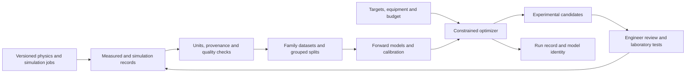

# Research and industrial development plan

Prepared **8 September 2026** using primary research, official technical documentation and the local audit. Vendor information is labeled separately. Proposed priorities, timelines and economics are engineering/business hypotheses, not validated customer findings.

## Product direction

Build a materials-process decision platform around **measured outcomes, constrained optimization and traceability**, with distinct physics/model modules for each family. Start with a narrow low-alloy steel heat-treatment pilot because it is closest to the existing workflow. Expand after demonstrating reproducible customer benefit.

The initial promise should be: “Reduce the trials needed to find a process that meets specified properties within your equipment limits, with a documented reason for each proposed experiment.” Universal discovery and guaranteed strongest/fastest materials are not supported promises.

Use a closed loop: record observations, fit/update models, select constrained experiments, measure outcomes and check transfer. Modern knowledge-augmented RL is relevant, but published benchmarks do not prove superiority on this steel problem. AIMATDESIGN compares RL-related design with classical search and active learning; this motivates equal-budget comparison rather than choosing by algorithm name. [AIMATDESIGN, 2026](https://www.nature.com/articles/s41524-025-01894-x)

## Industrial problems

| Problem | Product workflow | Pilot measurement |
|---|---|---|
| Costly heat-treatment trials | Propose bounded schedules for one grade/furnace/section range. | Trials to all-property success, pass rate, engineering time. |
| Poor recipe transfer | Condition on heat chemistry, initial state, geometry and cooling history. | Held-out heat/lot/furnace errors and drift. |
| Conflicting strength/toughness/ductility | Show feasible Pareto alternatives and target intervals. | Fraction meeting every required property; expert acceptance. |
| Raw-material variation/substitution | Re-optimize within procurement/formulation bounds. | Cost per accepted part and requalification effort. |
| Long or defective composite cures | Constrain exotherm, thermal gradients and degree of cure. | Actual cycle time, defects and part performance. |
| Difficult rubber/polymer formulation | Respect mixing basis, cure, viscosity and aging requirements. | Trials, processability, repeatability and service properties. |
| Fragmented data | Link specimen, batch, process, units, test method and instrument. | Ingestion time, usable data yield and traceability. |

NIST's 2026 manufacturing roadmap identifies data management, heterogeneous sensing/control integration and trustworthy operation as deployment challenges. Measurement infrastructure and validation therefore belong alongside model development. [NIST, July 2026](https://www.nist.gov/publications/2026-roadmap-artificial-intelligence-and-machine-learning-smart-manufacturing)

## Family-specific physics

### Steels

Represent composition, initial phases/grains, section geometry, full time-temperature path, transfer delays, quench conditions and tempering history. Expand low-alloy steels first. Tool, stainless, precipitation-hardening and advanced high-strength steels need different phase, carbide, transformation and strengthening models.

Use a calibrated chain: heat conduction and boundary transfer → phase kinetics → grain/precipitate evolution → properties. Conserve composition and phase fractions; constrain transport coefficients and use absolute temperature in thermodynamic/Arrhenius equations. Include latent heat when relevant. Fit residual errors on measured observations rather than treating every empirical formula as exact.

CALPHAD provides equilibrium phase/thermodynamic information, but equilibrium is not a quench-microstructure prediction. `pycalphad` supplies an equilibrium framework; it needs an appropriate assessed database and applicability checks. Its code license does not confer rights to every thermodynamic database. [pycalphad](https://pycalphad.org/docs/latest/)

Current commercial tooling already exposes material-category and processing-route selection: Thermo-Calc's 2026b release describes a Property Navigator including anneal/quench/temper workflows. A realistic MAST integration should complement established thermodynamic/kinetic tools with validated optimization and customer data, rather than claim novelty from a material selector alone. This is a vendor-reported capability. [Thermo-Calc 2026b](https://thermocalc.com/news/thermo-calc-2026b-release-overview/)

### Fiber composites

Store constituent identities, fiber volume fraction, architecture/layup, orientation, thickness, resin chemistry, void content and cure history. Use anisotropic stiffness/laminate mechanics for response and coupled heat transfer/cure kinetics for processing. Add residual stress and defects where required. A scalar steel model cannot represent orientation or cure state.

A 2025 study investigates constrained Bayesian optimization of simulated composite cure profiles. This fits the proposed time/quality tradeoff, but is simulation evidence, not proof of transfer to a customer's resin/autoclave. [Cure-process optimization preprint](https://arxiv.org/abs/2505.24775)

### Polymers

Store chemical representation, molecular-weight distribution, architecture, additives, crystallinity, orientation, moisture, processing and test conditions. Respect temperature/strain-rate dependence. Formulation optimization within known chemistries is a more accessible first product than unrestricted new-polymer synthesis.

Recent inverse-design work couples active learning with molecular simulation to target entire shear-dependent viscosity curves. This supports representing rheology as a response curve and encoding polymer architecture. It does not establish experimental industrial formulation performance. [Jiang and Webb, published December 2025; 2026 volume](https://www.nature.com/articles/s41524-025-01900-2)

### Elastomers

Keep formulation basis explicit: parts per hundred rubber (phr) is not wt% and need not total 100. Model polymer/filler/plasticizer/curative identities, mixing, crosslinking, cure/reversion and service conditions. Outcomes may include Shore hardness, tensile response, tear strength, compression set, hysteresis and aging. Use calibrated hyperelastic/viscoelastic laws where appropriate. HRC cannot be generically converted to Shore hardness.

This is a proposed engineering direction. No elastomer predictor or experimentally validated elastomer inverse-design capability is delivered here.

## Where DFT belongs

Use DFT when decisions depend on atomistic energetics, phase stability, elastic tensors, defect/solute interactions, interfaces or molecular chemistry. Materials Project documents a first-principles calculation ecosystem, not finished-part UTS for arbitrary manufacturing histories. [Materials Project methodology](https://docs.materialsproject.org/methodology/materials-methodology/overview)

MatterGen generates inorganic crystal candidates conditioned on requested characteristics. It may inform a future crystal-discovery branch; it does not replace process–microstructure modeling for heat-treated steel, cured composite or filled rubber. [Microsoft Research, January 2025](https://www.microsoft.com/en-us/research/blog/mattergen-a-new-paradigm-of-materials-design-with-generative-ai/)

Recommended sequence:

1. Reuse licensed, relevant calculations with tracked origin, functional, pseudopotentials, convergence and corrections.
2. Prioritize CALPHAD, kinetics and continuum simulation for the immediate steel-processing problem.
3. Add asynchronous high-fidelity jobs with input hashes, code/database versions, resource limits, cancellation and convergence checks.
4. Schedule DFT when sensitivity/uncertainty analysis indicates atomistic information could change the decision.
5. Fit surrogates to validated calculations; separate experimental discrepancy from numerical convergence error.

No paid solver, DFT calculation or cloud training run has been initiated. No DFT result is fabricated by the application.

## Optimization and efficiency

For expensive experiments and small datasets, begin with group-validated tabular models or Gaussian processes and constrained Bayesian optimization. For cheap differentiable surrogates, compare random/space-filling search, gradient methods and evolutionary search. Use a learned policy when repeated queries justify training costs, or RL when decisions are truly sequential and observations change the next action.

BoTorch distinguishes parameter constraints from modeled outcome constraints. MAST should do the same: a furnace temperature ceiling is a hard input restriction; predicted toughness is uncertain and needs outcome validation. [BoTorch constraints](https://botorch.org/docs/constraints)

The delivered code has random/policy/hybrid search, not Bayesian optimization. The local benchmark in `outputs/search_benchmark.json` uses three presets, three seeds, 300 candidates and one target vector. Mean best scores were −0.4162 policy, −0.4005 random, −0.4039 hybrid (higher is better). Mean times were approximately .055/.014/.037 seconds with two CPU threads, excluding loading. None of the displayed candidate sets met all six targets within 15%. These narrow results favor random search on this workload; they establish neither broad superiority nor physical infeasibility.

Future comparisons must fix query budget, wall time, feasible domain and target suite. Report all-property success, Pareto hypervolume where meaningful, constraint violations, rejected candidates, training cost and amortized latency. Repeat on independent heats and future lots. Never use one surrogate as optimizer and sole source of “ground truth.”

## Architecture

The Python core now separates checkpoint architecture, domain checks, inference, physics primitives and data evaluation from Streamlit. Future family adapters need schema, validation, prediction, uncertainty, feasible process space and explanations. A family label must not activate an absent model.

A commercial service additionally requires authenticated tenant/project access, encrypted storage, immutable model/run versions, workers, quotas, scheduling, monitoring, backup/restore, export and retention controls. Enforce isolation in storage, APIs and workers, not only the browser. Keep reviewed experimental proposals separate from equipment control. The current local research app has no subscription billing or multi-tenant operation.

## Commercial positioning

Citrine presents materials/formulation optimization and enterprise onboarding/security; MaterialsZone presents integrated materials data and R&D workflows. These vendor pages show established product expectations around integration and deployment. Their claims are not independent evidence of algorithmic superiority. [Citrine](https://citrine.io/), [MaterialsZone](https://www.materials.zone/)

Test a differentiator of narrowly validated physics-aware process development with visible constraints and experimental traceability. “Uses RL” alone is neither a customer benefit nor durable differentiation.

Interview heat-treatment shops, manufacturers, laboratories and compounders. Request examples of costly failed trials, available chemistry/process/test records, actual acceptance criteria, approval workflows, sharing limits and value calculations. Public data availability does not imply commercial training/reuse permission.

Start with a scoped paid pilot delivering an evaluated workflow and experimental results. If value repeats, test annual site/team subscriptions with a separate compute allowance; private deployment may suit enterprise clients. Determine price through value and customer discovery. This report makes no market-size, revenue or willingness-to-pay claim.

Pilot value: avoided experiments × fully loaded trial cost + accepted-part cycle savings + avoided scrap/rework − software/integration/compute costs. Measure against the customer's baseline. Fast surrogate inference is not evidence of increased factory throughput.

## Gates and next decisions

| Gate | Deliverable | Exit evidence |
|---|---|---|
| 0: Research integrity | Audit, constrained legacy app, reproducible runs, tests and data contract. | Passing software checks, explicit legacy status. Delivered here. |
| 1: Data partnership | One process/grade scope, permissioned records, agreed tests. | Traceable specimens/heats/units and independent holdout. |
| 2: Physics repair | Reviewed transformation/thermal model and measured baseline. | Limiting cases, sensitivity checks, held-out errors and calibration. |
| 3: Prospective pilot | Bounded experiments versus current practice. | Real all-property pass rate and trial/cycle/cost benefit. |
| 4: Operational service | Tenant controls, jobs, release/rollback and support. | Isolation/recovery checks and operational acceptance. |
| 5: New families | One separately validated module at a time. | Family-specific records, physics and prospective evidence. |

Planning assumptions after data access: 2–4 weeks for data qualification, 4–8 weeks for physics/baselines if records are usable, 6–12+ weeks for trials depending on laboratory availability. These are not commitments. Aging, fatigue and new synthesis campaigns can require much longer.

Next indispensable inputs: first customer/use case, measured records with reuse rights, equipment and geometry ranges, test conditions, engineering tolerances and trial budget. Additional synthetic training alone cannot replace these inputs.
